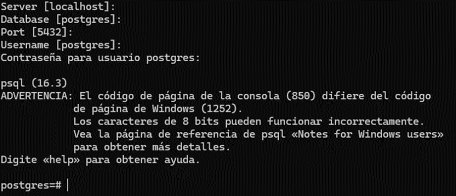

En primer lugar, accedemos a la Shell de PostgreSQL:



Luego ejecutaremos el siguiente comando:
```sql
CREATE DATABASE nombredb;
```
Luego es recomendable crear el usuario que tendrá acceso a dicha base de datos, con su contraseña:
```sql
CREATE USER nombreuser WITH PASSWORD 'password';
```
Después le damos permisos al usuario sobre la base de datos. Desde PostgreSQL 15 también hay que darle permisos sobre el esquema `public`, así que nos conectamos a la base de datos y lo hacemos ahí:
```sql
GRANT ALL PRIVILEGES ON DATABASE nombredb TO nombreuser;
\c nombredb
GRANT ALL ON SCHEMA public TO nombreuser;
```
Con estos simples pasos ya se ha creado la base de datos y hemos asignado un usuario a la misma, solo con esta configuración podemos realizar nuestras migraciones en Django.

***Observación: no olvides el `;` al final de cada comando SQL (los comandos que empiezan con `\`, como `\c`, no lo necesitan).***

## Eliminar Base de Datos

En caso de que necesitemos eliminar nuestra base de datos debemos acceder de igual manera a la **Shell de PostgreSQL** y ejecutar el siguiente comando:
```sql
DROP DATABASE nombredb;
```
Solo así ya habremos eliminado nuestra Base de Datos.
